

#  EliteMining

  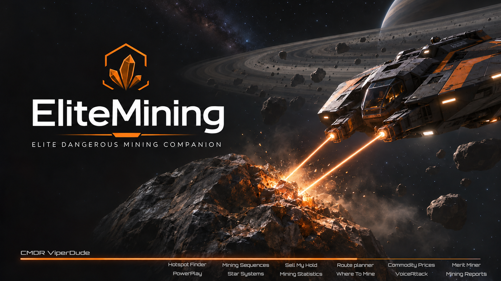

**EliteMining** is a mining companion for Elite Dangerous. Find hotspots, compare sell prices, track mining sessions, and receive mineral announcements without VoiceAttack. Optional VoiceAttack integration adds voice commands, hotkeys, and automated mining sequences.

💡 **Tip:** Most tables throughout the app support right-click for additional options — copying data, opening systems in Inara/EDSM/Spansh, saving to your local database, exporting results, and more context-specific actions. Sorted columns show an up/down arrow, and hovering a comment or note shows its full text.

---

Table of Contents

- [Features and Usage Options](#features-and-usage-options)
- [Requirements](#requirements)
- [Installation](#installation)
  - [Enable VoiceAttack Plugins](#enable-voiceattack-plugins)
- [VoiceAttack Controls](#voiceattack-controls)
  - [Voice Feedback](#voice-feedback)
- [EliteMining App](#elitemining-app)
  - [Themes](#themes)
  - [Customize Table Columns](#customize-table-columns)
  - [Text Overlay](#text-overlay)
- [Hotspot Finder](#hotspot-finder)
- [PowerPlay Merit Mining](#powerplay-merit-mining)
- [Commodity Market](#commodity-market)
  - [Sell My Hold](#sell-my-hold)
- [Mining Missions](#mining-missions)
- [Ring Mining Reference](#ring-mining-reference)
- [Star Systems](#star-systems)
- [Distance Calculator](#distance-calculator)
- [Fleet Carrier](#fleet-carrier)
- [Backup & Restore](#backup--restore)
- [Getting Started](#getting-started)
- [Mining Session](#mining-session)
  - [Session Options](#session-options)
  - [Analytics](#mining-analytics)
  - [Reports](#reports)
  - [Statistics](#mining-statistics)
- [Bookmarks](#bookmarks)
- [Ship Presets & Cargo Monitor](#ship-presets--cargo-monitor-sidebar)
- [Settings](#settings-tab)
  - [Announcements](#announcement-panel)
- [VoiceAttack Commands](#voiceattack-commands)
- [Mining Presets](#mining-presets)
- [Usage Tips](#usage-tips)
- [Compatibility](#compatibility)
- [Known Limitations](#known-limitations)
- [Training Speech Recognition](#training-speech-recognition)
- [FAQ](FAQ.md)
- [Community & Resources](#community--resources)
- [License](#license--third-party-notices)
- [Credits](#credits)

---

## Features and Usage Options

### Standalone (Without VoiceAttack)

- **Find mining spots** — Search 80,000+ hotspots and galaxy-wide ring data, including overlaps and RES sites.
- **Find buyers** — Compare mineral prices, trade goods, or sale options for your whole cargo hold.
- **Track mining** — Live prospector reports, cargo and engineering materials, session history, charts, and reports.
- **Hear announcements** — Choose minerals and thresholds, with optional in-game text overlays.
- **Manage your setup** — Mining missions, bookmarks, ship presets, and backup/restore.

See [Session Options](#session-options) for automatic session start, resume, and end.

### With VoiceAttack Integration (Optional)

Adds voice/hotkey mining sequences, collector and prospector deployment, targeting, repeated mining cycles (1–10), and ship presets. The installer includes [EliteVA by Somfic](https://docs.somfic.dev/projects/eliteva).

[Back to Top](#top)

---

## Requirements

Click to expand

**Essential:**  
- **Windows 10/11** (64-bit)
- **Elite Dangerous** (PC version)  
- **500 MB free disk space** (for installation and local data cache)

**For VoiceAttack Integration:**  
- **[EliteVA (API) by Somfic](https://docs.somfic.dev/projects/eliteva)** *(included in installer)*  
- **[VoiceAttack](https://voiceattack.com/)** – Paid version  
- **Microphone** for voice commands  

### Keybind Requirement for EliteVA

EliteVA requires a custom keybinds file (such as `Custom.binds`, `Custom.*.binds`, or an HCS `Custom.*.*.binds` file):

- If you already use a custom keybinds file (for example, from HCS VoicePacks or your own setup), you’re all set—no changes needed.
- If you don’t have a custom keybinds file yet:
  1. Open **Elite Dangerous → Options → Controls**
  2. Set preset to **Custom**
  3. For each controller you want to use (keyboard, mouse, joystick, HOTAS, gamepad), make sure to assign at least one key or button in each of the four controller sections (Keyboard, Mouse, Joystick, Gamepad).  
     - This ensures Elite Dangerous saves your bindings for all devices.
  4. Click **Save** — this will create or update your `Custom.binds` file (or a similarly named custom file).

**Tip:**  
If you use multiple controllers, always check that each one is recognized and has at least one binding set before saving. This prevents missing controls in your custom binds file.

### Custom Keybinds for Mining Control  
VoiceAttack profile includes a dedicated **"Custom Keybinds for Mining Control"** category. Configure your mining hotkeys here instead of searching through the entire profile.

**Note:** VoiceAttack is optional. EliteMining App can run standalone.  

[Back to Top](#top)

---

## Installation

- **Installer:** Run `EliteMiningSetup.exe` (includes VoiceAttack profile)  

> **Antivirus Notice:** If your antivirus flags the application, this is a common false positive with Python-compiled apps - simply add an exclusion for the installation folder.
> 
> **After Updates and New Installs:** System/ring location may appear empty until you relog into Elite Dangerous (one-time refresh).

### Included Components  
The installer bundles the **EliteVA plugin**. No separate download required.  

### VoiceAttack  Installation  
1. Open VoiceAttack → Profile → Import Profile  
2. Select the bundled **EliteMining profile** (`EliteMining v<version>-Profile.vap`)
3. Configure your mining hotkeys in the **"Custom Keybinds for Mining Control"** category

### Enable VoiceAttack Plugins
VoiceAttack must have plugin support enabled and the EliteAPI plugin activated:

1. Open **VoiceAttack → Options → General**
2. Enable **"Enable Plugin Support"** checkbox
3. Click **"Plugin Manager"**
4. Enable this plugin:
   - ✓ **EliteAPI (v4 EliteVA.dll)**
5. Click **OK** and **restart VoiceAttack** for changes to take effect

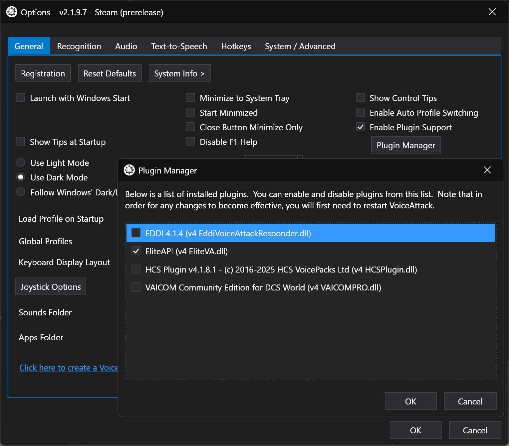 
*Enable the EliteAPI plugin in VoiceAttack*

### Preserving Keybinds During Updates (v4.76+)
When a new VoiceAttack profile is available, EliteMining guides you through preserving your keybinds:
1. Start EliteMining after updating
2. Follow the on-screen prompt to export your current profile as XML
3. Select the exported file
4. Your keybinds will be automatically merged into the new profile
5. Import the updated profile in VoiceAttack

**Manual method:** You can also export your profile beforehand (Profile → Export Profile, save as XML format) and use it during the merge process.

### Adding Custom Commands

**Recommended:** Create a separate profile for your custom commands instead of editing the EliteMining profile directly.

1. In VoiceAttack, create a new profile (e.g., "My Custom Commands")
2. Add your custom commands to this profile
3. Open the EliteMining profile → **Profile Options** → **Include Commands from Other Profiles**
4. Select your custom profile from the list

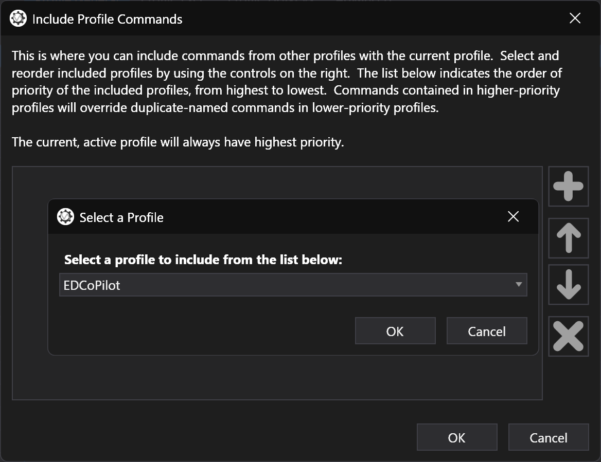 
*Include custom profiles to add your own commands without modifying EliteMining*

Your custom commands stay separate and survive EliteMining profile updates and keybind merging.

**Note:** Commands in EliteMining profile take priority over included profiles if names conflict.

[Back to Top](#top)

---

## EliteMining App  

Use the app to track mining, search for locations and prices, and configure announcements and optional VoiceAttack automation.

### Start EliteMining  
- EliteMining Desktop icon or direct: `\EliteMining\Configurator\EliteMining.exe`

### Themes

Choose **Classic Orange**, **Classic Dark**, **Navy**, **Modern Dark**, or **Modern Orange** using the theme button at the bottom of the app or in **Settings → General Settings**. **Navy** is the default for new installs. Changing themes requires a restart; table functions and column customization work across all themes.

### Customize Table Columns

Click **Columns** above a table to open **Customize Columns**. Select a column and use **Move Left** or **Move Right** to change its position, and tick **Visible** for the columns you want to see.

- **Apply** saves the order and visibility separately for each table and keeps them between app restarts.
- **Cancel** discards changes.
- **Reset to Default** restores the original order and shows all available columns; click **Apply** to save the reset.

Column settings open only through the **Columns** button. Right-clicking rows still opens their usual action menus.

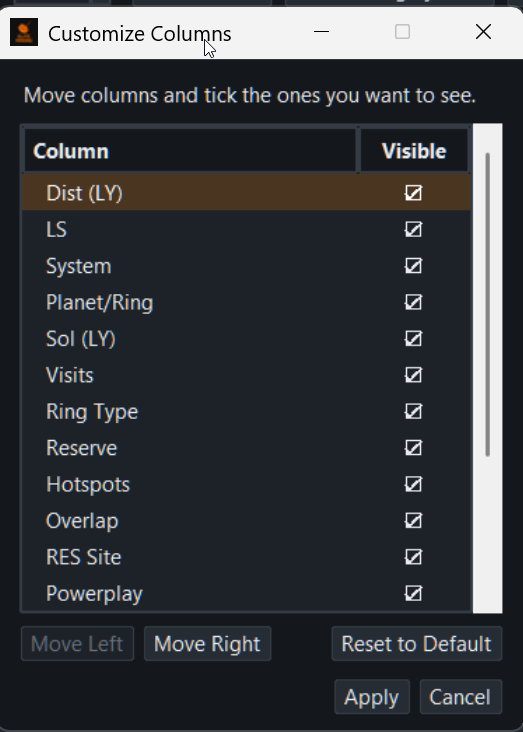 

[Back to Top](#top)

---

## VoiceAttack Controls

Configure automation sequences for VoiceAttack integration. These settings can be adjusted via GUI even if running standalone.

### Firegroups & Fire Buttons

Configure Elite Dangerous firegroups (A-H) and fire buttons (Primary/Secondary) for automated mining sequences:

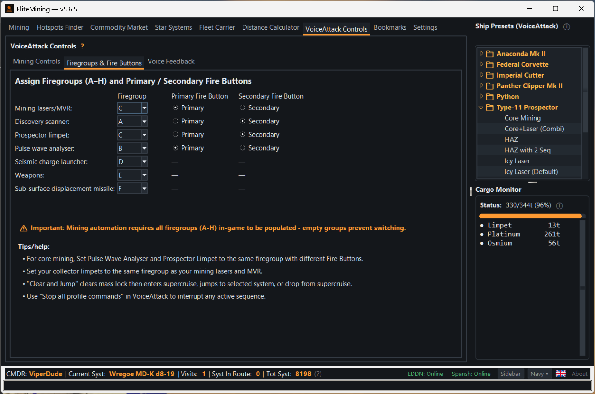 
*Firegroups configuration for mining tools and fire button assignments.*

**Available Tools:**
- **Mining Lasers/MVR** – Automated laser mining with configurable duration
- **Discovery Scanner** – System honk on FSD arrival  
- **Prospector Limpet** – Launch and auto-target asteroids
- **Pulse Wave Analyser** – Core asteroid scanning
- **Seismic Charge Launcher** – Fissure targeting for core mining
- **Weapons** – Defense firegroup configuration
- **Sub-surface Displacement Missile** – Deposit extraction

### Mining Controls (VoiceAttack)

Control mining sequence timing and automated behaviors:

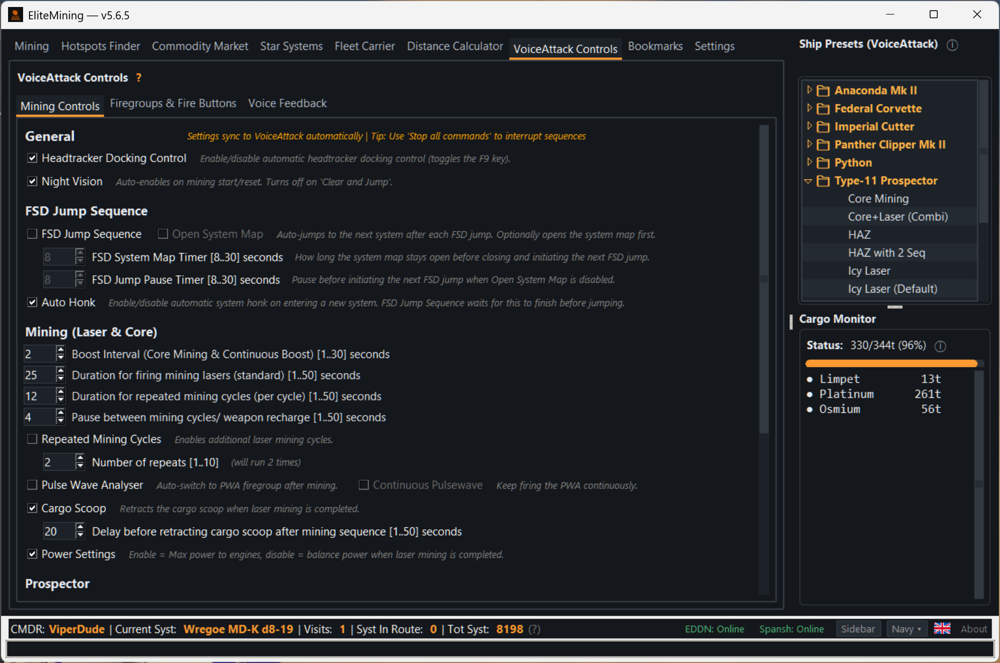 
*Mining controls for automation sequences.*

**Timers:** Configure duration for laser periods, pauses, and delays (1-50 seconds range)

**Toggles:**
- **Cargo Scoop** – Auto-retract when mining completes
- **Headtracker Docking Control** – Toggle headtracker (F9) for docking
- **Laser Mining Extra** – Second laser period with cooldown pause
- **Night Vision** – Auto-enable when starting mining
- **Power Settings** – Max engines during mining, balance when complete
- **Prospector Sequence** – Auto-target prospector after launch
- **Pulse Wave Analyser** – Auto-switch to PWA firegroup after mining
- **Target** – Deselect prospector when mining completes

**FSD Jump Sequence:**
- **FSD Jump Sequence** – Auto-jumps to the next system after each FSD jump
- **Open System Map** – Optionally opens/closes the system map before the jump
- **FSD System Map Timer** (8-30s) – How long the map stays open, used when Open System Map is on
- **FSD Jump Pause Timer** (8-30s) – Pause before the next jump, used when Open System Map is off
- **Auto Honk** – Scan system automatically on FSD arrival; FSD Jump Sequence waits for this to finish, works independently of it

All FSD Jump Sequence settings above are saved as part of ship presets.

**Prospector:**
- **Prospector Sequence** – Master control; enables Target Prospector and Thrust Up
- **Continuous Seq.** – Keep repeating the prospector sequence automatically
- **Continuous Prospector Sequence Timer** (1-30s, decimals allowed e.g. 2.5) – Pause between each cycle of the Continuous Sequence; greyed out while Continuous Seq. is off
- **Prospector cooldown time** (1.0-6.0s, default 2.6s) – Time before you can fire the next prospector
- **Prospector Sound Effect** – Audio notification when the cooldown ends and the next limpet is ready to fire
- **Thrust Up** – Apply upward thrust when firing a prospector
  - **Thrust up duration** (0.5-3.5s, default 1.5s) – Duration of the upward thrust
  - **Delay Thrust up scoop retracted/closed** (0.0-5.0s, default 1.6s) – Delay before thrust up when the cargo scoop is retracted
  - **Delay Thrust up scoop deployed/open** (1.0-5.0s, default 3.8s) – Delay before thrust up when the cargo scoop is deployed

💡 **Tip:** Use "Stop all profile commands" in VoiceAttack to interrupt any active sequence.

💡 **Reset interrupted / out-of-sync sequences:** If a mining sequence is interrupted and a toggle ends up in the wrong state (e.g. lasers won't fire when they should), use the **"Stop and Reset"** command (also recognised: *"Stop and reset all profile commands"*, *"Stop all"*, *"Reset all"*) to clear every sequence flag and return the profile to a clean baseline.

### Voice Feedback

Plays a sound or spoken voice for mining events, such as starting or resetting the mining sequence. Pick a sound set and a female or male voice per event, or use a computer voice instead.

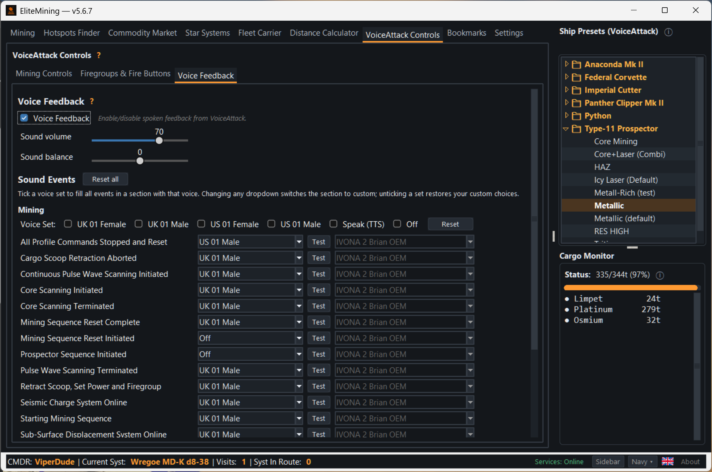 

[Back to Top](#top)

---

## Hotspot Finder

Search saved hotspots and Spansh ring data by mineral, ring type, and distance. Right-click results for prices, bookmarks, and ring data.

### Key Features

#### Searching and Filters

- **Data Source** — Choose Local Database (saved rings and scans), Spansh, or Both. Ring Type Only finds rings without requiring hotspots.
- **Mineral and ring filters** — Choose a mineral, ring type, distance, and minimum hotspot count (1–20 when a mineral is selected).
- **Search range** — Local searches support up to 500 LY; Spansh hotspot coverage is typically around 50 LY, and Ring Search reaches 300 LY.
- **Overlaps and RES sites** — Find double/triple hotspots and Resource Extraction Sites. The bundled data includes 161 overlaps and 71 RES locations.
- **Power/State** — Available for Local Database searches. Fortified/Stronghold searches use Spansh up to 500 LY; other states use locally received data and Max Distance.
- **PowerPlay checkbox** — Off uses saved PowerPlay information for faster searches. On also checks Spansh. Your own visits update information immediately; coverage elsewhere depends on other commanders. Double-click a System or PowerPlay cell to open Inara and refresh its PowerPlay information.

#### Prices and PowerPlay

- **Best Minerals to Mine** — Right-click a ring or system to compare sell prices for its hotspot minerals. Use **+ add** to include minerals without hotspots, such as Osmium.
- **Auto Prices** — With Auto-Search enabled, fetch prices after arriving in a system with known hotspots. Use **Auto Options > Auto Prices Options** to choose in-system prices or [overlay results](#text-overlay).
- **Find Acquisition Systems** — Right-click a Fortified/Stronghold system to find nearby Unoccupied systems buying your mineral. See [PowerPlay Merit Mining](#powerplay-merit-mining).

#### Saving and Automatic Updates

- Journal scans are imported automatically, and newly discovered hotspots are tracked.
- **Auto Options** (Hotspots Finder) holds the Auto-Search, Auto Switch and Auto Prices checkboxes in one dropdown.
- **Auto-Search** searches after jumps and refreshes after ring scans; your choice is remembered.
- Right-click Spansh results to save up to 50 selected rows locally or update missing reserve levels.
- **Auto-Save** (Spansh/Both only, off by default) saves new hotspots without changing existing entries.

### Setting & Managing Overlap/RES Data
- **Edit Ring Data** – Right-click a ring saved in your local database to set hotspot counts, reserve level, overlaps (2x, 3x), RES sites (Hazardous, High, Normal, Low), ring type, visit count and density
- **Remove Overlap/RES** – Select "None" for overlap, or untick the RES boxes, to remove existing entries
- **Bookmarks** – Overlap and RES data saved in bookmarks also syncs to the Ring Finder database
- Data is stored locally and appears in all future searches

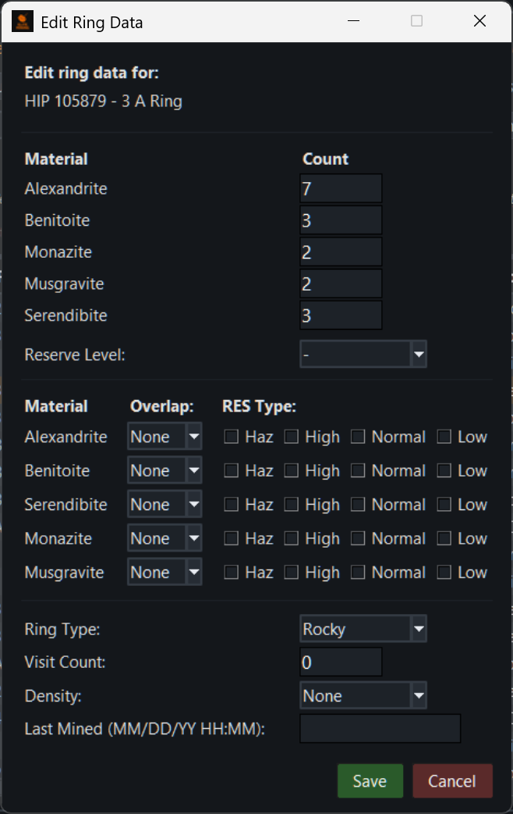 
*Edit Ring Data, opened from the right-click menu.*

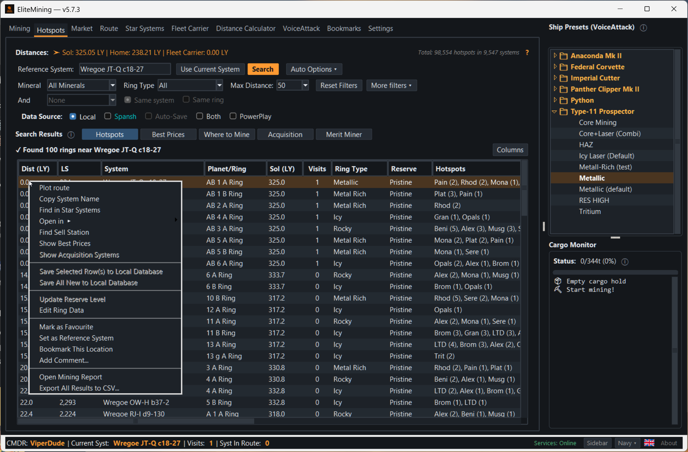 
*Hotspot Finder showing search results with minerals filters and distance calculations.*

View acquisition searches and mineral price examples

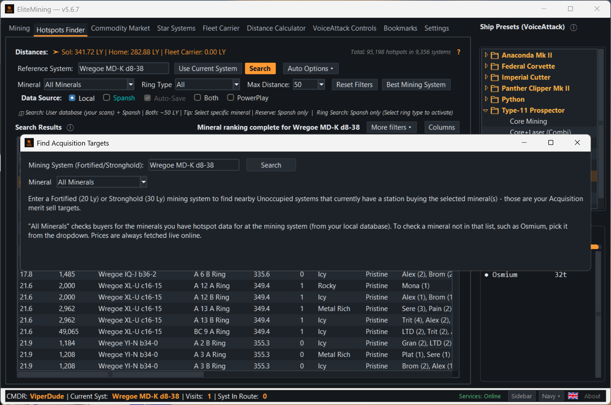 
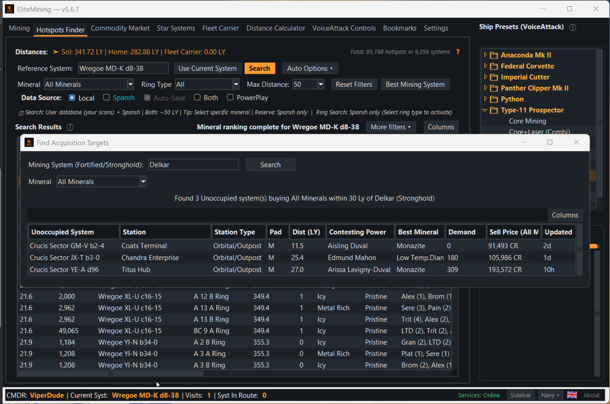 
*Find Acquisition Systems: search for nearby Unoccupied systems and compare their buyers.*

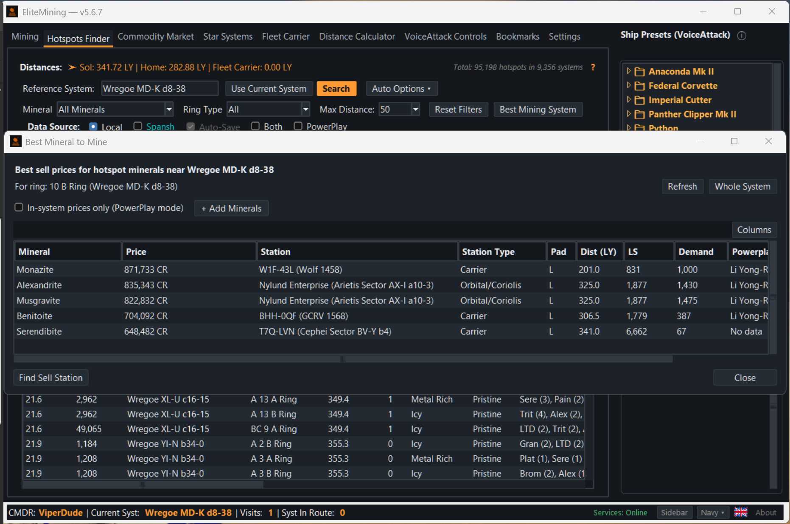 
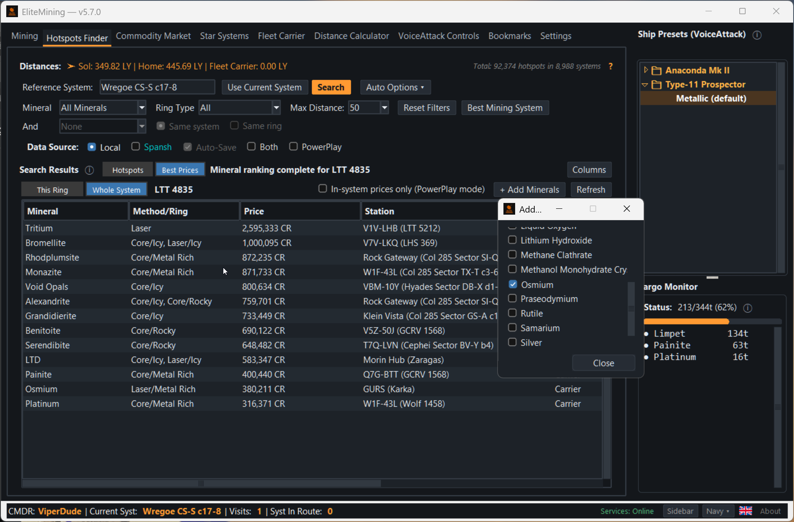 
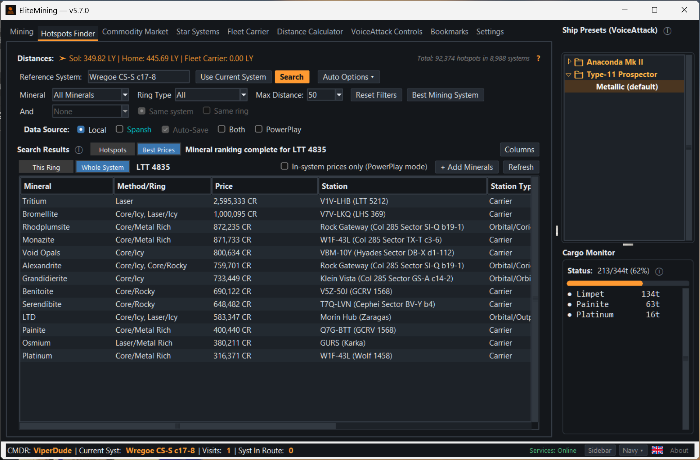 
*Best Minerals to Mine for a ring or the entire system.*

[Back to Top](#top)

---

## PowerPlay Merit Mining

Where you sell your mined goods matters just as much as where you mine them.
- **Reinforcing your own Power's system or Undermining a rival's** — you must mine and sell in that same system. Selling elsewhere earns no Powerplay merits for that cargo.
- **Acquiring an Unoccupied system** — you sell in the Unoccupied system itself, but the goods can be mined anywhere within 20 ly of it if your nearest system is Fortified, or 30 ly if it's a Stronghold.

How the app helps (all in the [Hotspot Finder](#hotspot-finder)):
1. **Power/State filter** – find Fortified or Stronghold systems to mine in.
2. **Best Minerals to Mine / Auto Prices** – see the best sell prices for your minerals.
3. **Find Acquisition Systems** – right-click a Fortified or Stronghold system to list nearby Unoccupied systems buying your mineral.

[Back to Top](#top)

---

## Commodity Market

Find buyers for your mined cargo or stations selling trade goods. Choose a reference system, search mode, and filters, then click **Search**.

### Key Features

| Tab | Use it to |
|---|---|
| Mining Commodities | Find prices for one mining commodity. |
| Multiple Prices | Compare buyers for up to five minerals at one station. |
| Sell My Hold | Compare one-stop, nearby, and two-stop sales for your cargo, reserving mission requirements. |
| Trade Commodities | Search trade goods across 15 categories. |

- **Near System / Galaxy-Wide** — Search around your reference system (up to 500 LY) or across the galaxy.
- **Sell / Buy** — Find stations buying your cargo or selling goods you want.
- **Filters** — Choose station type, landing pad size, and whether to include Fleet Carriers.
- **Results** — Compare prices, demand, distance, and price age. Click headers to sort. Double-click a System/Station cell for Inara; right-click for external links or copying.

Prices combine Ardent, Spansh, and reports from other commanders. Coverage varies, and prices and demand can change before you arrive. Check the price age before travelling.

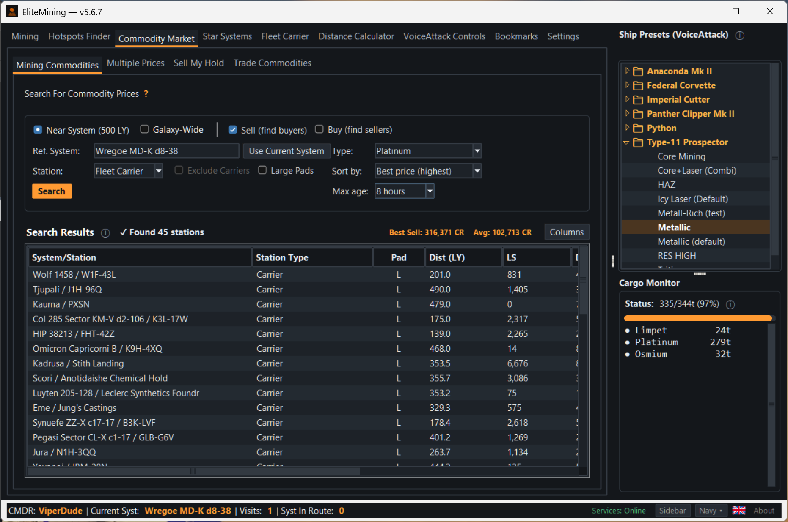 
*Commodity Market showing mining commodities search results with filters and distance calculations.*

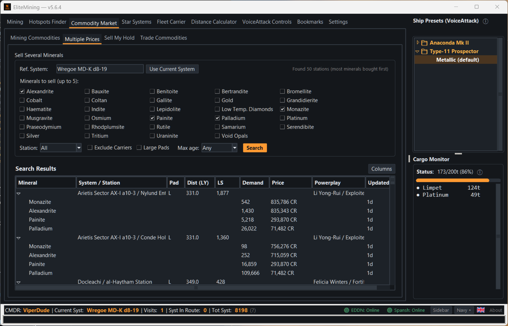 
*Multiple Prices tab ranking stations by how many of your chosen minerals they buy, with demand and price per mineral. In Ring Finder, Find Sell Station opens it with a ring's minerals pre-selected.*

### Sell My Hold

Use **Current System** or enter another reference system, choose your search radius, pad size, carrier and price-age filters, then click **Search**. EliteMining reads your cargo and compares the best one-stop payout, a nearby sale, and a two-stop option when it earns more. Limpets are excluded, and cargo still needed for tracked mining missions is reserved automatically.

Select an option to see what to sell at each stop, including quantities, prices, demand and price age. Unsold cargo is shown separately. Payouts are estimates; actual prices and demand may change. Distances are straight-line distances, not jump routes or travel times.

Drag the divider to resize the tables, and use **Columns** to reorder or hide columns. Hover over headers for explanations. Right-click either table to copy a system name or open Inara, EDSM or Spansh; double-click opens Inara for that row's system, or the first stop in a two-stop option. Search choices and table layout are remembered between restarts.

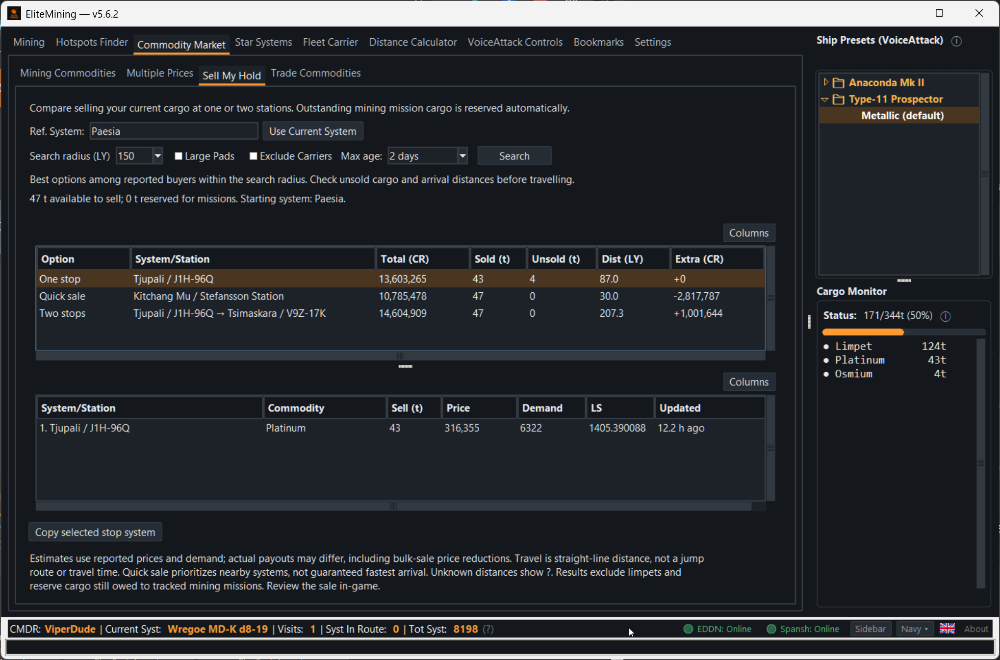 
*Sell My Hold showing cargo sale options and the selected plan's station and commodity details.*

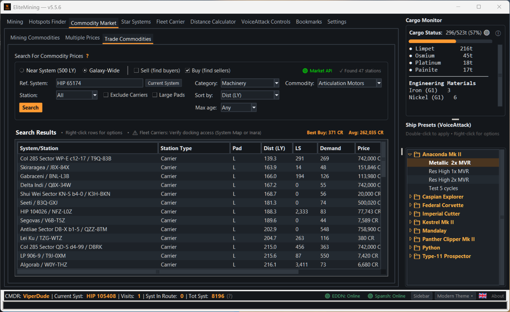 
*Trade Commodities tab with 15 categories covering all tradeable goods in Elite Dangerous.*

[Back to Top](#top)

---

## Mining Missions

Track your active mining missions and quickly find hotspots matching mission requirements.

### Key Features
- **Mission Tracking** – View all active mining missions with commodity requirements and progress
- **Find Hotspots** – Search for hotspots directly from mission commodity requirements
- **Auto-Import** – Missions automatically imported from Elite Dangerous journals

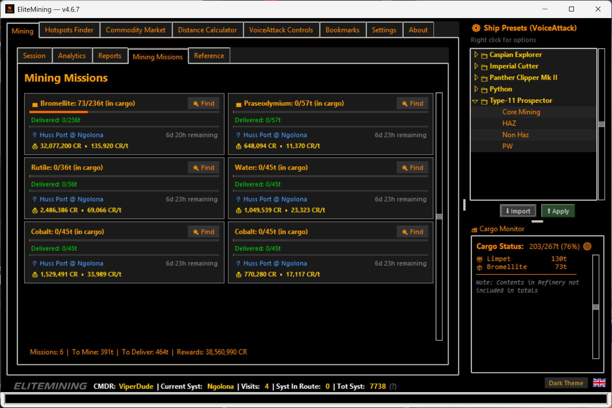 
*Mining Missions tab showing active missions with quick search options.*

[Back to Top](#top)

---

## Ring Mining Reference

Quick reference guide for ring types and mining minerals, accessible from the Mining tab.

### Key Features
- **Ring Type Guides** – Expandable sections for Icy, Metallic, Metal-Rich, and Rocky rings
- **Mineral Categories** – Laser (High/Low) and Core (High/Low) minerals for each ring type
- **RES Sites Reference** – Resource Extraction Site types with pirate levels and mining bonus percentages

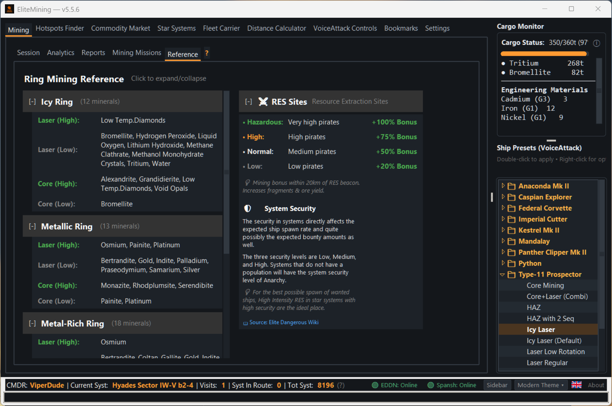 
*Ring Mining Reference showing ring types and RES site bonuses.*

[Back to Top](#top)

---

## Star Systems

Search for nearby star systems with detailed status information. Perfect for finding systems with specific conditions for missions, bounty hunting, or exploration.

### Key Features
- **Current System Info** – View detailed status of your current system (security, allegiance, government, state, economy, population)
- **Nearby System Search** – Find systems within range of your reference system
- **Server-Side Filtering** – Filter by Security, Allegiance, Government, State, Economy, Population
- **Nearest Material Trader** – Find the closest Encoded, Manufactured, or Raw material trader, showing station name, type, landing pad size, and distance to arrival
- **Distance Sorting** – Results sorted by distance from reference system
- **Quick Actions:**
  - Right-click → **Find Hotspots** to jump directly to Hotspots Finder with the selected system as reference and trigger a search
  - Right-click to copy system name or open in Inara/EDSM/Spansh
  - Double-click a System cell to open the system on Inara
  - **Use Current System** fills the reference system instantly

**Note:** The Elite Dangerous journal does not report the Unoccupied Powerplay state. The app infers this state when no controlling Power is present and updates it automatically when newer EDDN data becomes available.

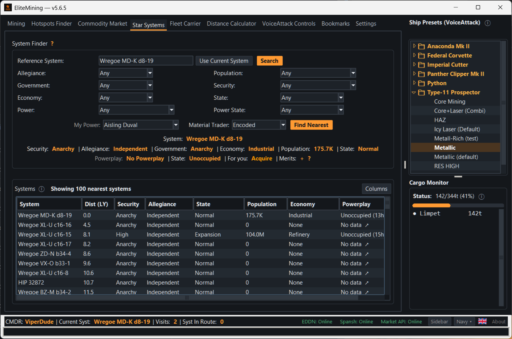 
*Star Systems tab showing current system info and nearby system search with filters.*

[Back to Top](#top)

---

## Distance Calculator

Calculate distances between any two systems using real-time EDSM data. Perfect for planning long-distance trips, tracking your home base, or finding your fleet carrier.

### Key Features
- **System Distance Calculator** – Calculate precise jump distances between any two star systems
- **Home System Tracking** – Save your home system and see distance from your current location in real-time
- **Fleet Carrier Tracking** – Auto-detect your fleet carrier location from journals or set manually
- **Coordinates & Sol Distance** – View galactic coordinates and distance to Sol for all systems
- **Live Updates** – Distances to Home and Fleet Carrier update automatically when you jump systems
- **Session Memory** – Remembers your last calculated systems and settings between app restarts
- **Quick Actions:**
  - "Use Current" button fills with your current system instantly
  - "Home" and "FC" buttons quickly fill destination field
  - Press Enter to calculate without clicking

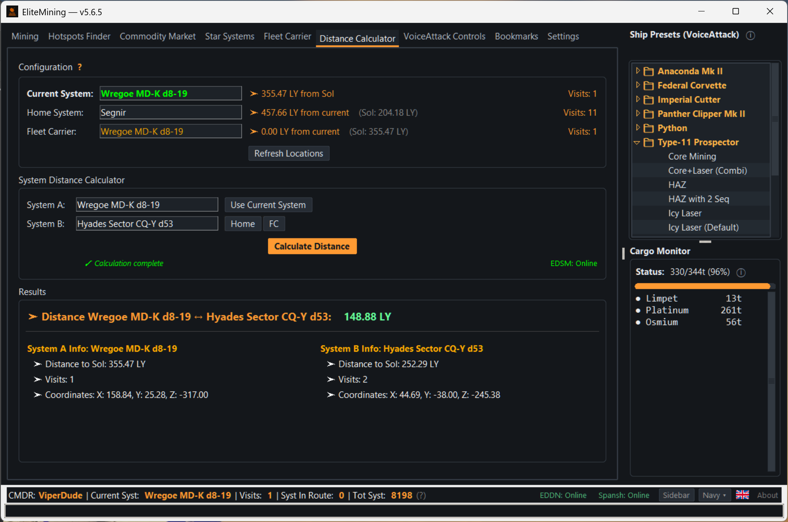 
*Distance Calculator showing system distances with Home and Fleet Carrier tracking.*

[Back to Top](#top)

---

## Fleet Carrier

Monitor your fleet carrier status at a glance — populated automatically from your Elite Dangerous journal files.

### Key Features
- **Live Status** – Carrier name, callsign, current location, docking access and tritium fuel level
- **Jump Schedule** – Destination, body, departure time and live countdown timer
- **Finances** – Carrier balance, available funds, reserve balance and reserve percentage
- **Services** – All installed and active services listed; inactive/not-installed shown in grey
- **Cargo Capacity** – Total capacity, cargo in use, crew modules and free space
- **Jump History** – Last 10 jump destinations with timestamps
- **VoiceAttack** – Say *"Show fleet carrier tab"* to switch directly to this tab

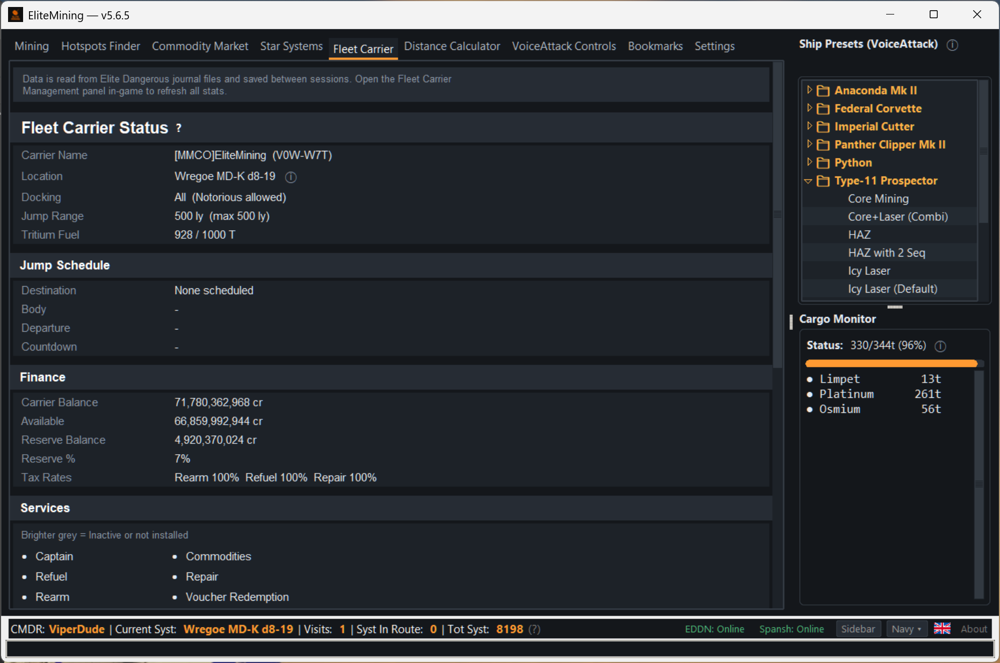 
*Fleet Carrier tab showing live status, finances, services and cargo.*

[Back to Top](#top)

---

## Getting Started

### Standalone Quick Start

1. Start EliteMining and log into Elite Dangerous so the app can read your current system and ship.
2. Use [Hotspot Finder](#hotspot-finder) to choose a mining location.
3. In **Mining → Session**, enable **Auto-start**, then fire a prospector limpet to begin tracking.
4. Configure minerals and thresholds in [Settings → Announcements](#announcement-panel).
5. End the session to save it, review [Reports](#reports), and use [Commodity Market](#commodity-market) to find buyers.

### VoiceAttack Setup

Complete [VoiceAttack installation](#voiceattack--installation) first, then configure the firegroups and hotkeys below.

Firegroups and hotkeys

### Firegroup (FG) Setup  
| Component | FG | Fire Button | Notes |
|-----------|----|-------------|-------|
| Mining Lasers (MVR) | Preset/Command | Primary | – |
| Discovery Scanner | Preset/Command | Secondary | – |
| Prospector Limpet Controller | Same as PWA | Secondary | Must set manually |
| Pulse Wave Analyser | Preset/Command | Primary | – |
| Seismic Charge Launcher | Preset/Command | – | – |
| Weapons | Preset/Command | – | – |
| Sub-surface Displ Missile | Preset/Command | – | – |
| Collector Limpet Controller | Preset/Command | – | Must set manually |

> **⚠️ Important for Automated Firegroup Switching:**  
> For the mining sequence automation to work correctly, **ALL firegroups (A through H) must be populated** in Elite Dangerous, even if you don't actively use them. Not populated firegroups will prevent automatic switching.
> 
> 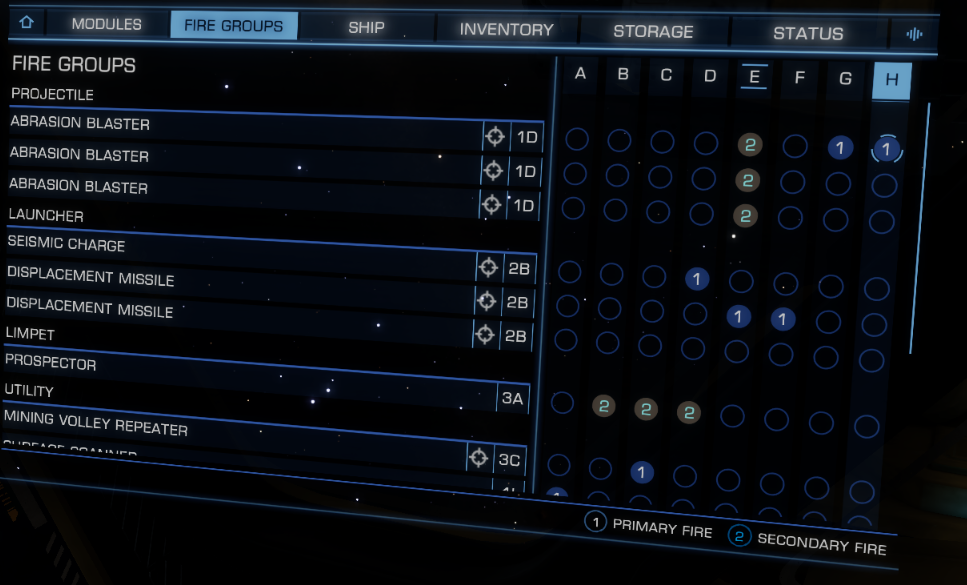 
> *Example: All 8 firegroups configured (A-H). Unused groups can have any weapon assigned.*

> **⚠️ Important for Prospector Sequence:**  
> For the prospector sequence to work correctly, make sure your **joystick or HOTAS fire button is not bound to the same fire button assigned to the Prospector Limpet Controller** in Elite Dangerous. If it is, the joystick will interfere with the automated sequence and prevent it from firing correctly.
> 
> 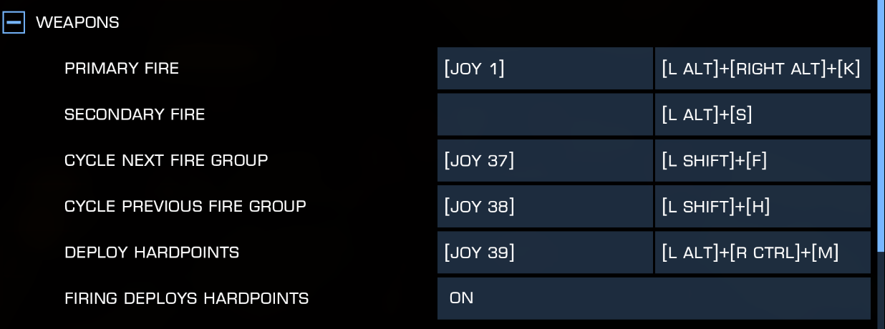 
> *Example: JOY 1 is bound to Primary Fire. If your Prospector Limpet Controller is also set to Primary, remove the joystick binding from Primary Fire in the Elite Dangerous controls menu.*

### Key / HOTAS Bindings  
| Action | Description |
|--------|-------------|
| Start mining sequence | Begin automated mining |
| Start prospector | Start prospector sequence |
| Reset mining sequence | Reset to default state |
| Deploy seismic charge launcher | Fire seismic charge |
| Deploy Sub-Surface Displacement Missile | Fire SSDM |
| Deploy weapons | Deploy hardpoints |
| Start Pulse wave scanning | Enable PWA scanner |
| Stop Pulse wave scanning | Disable PWA scanner |
| Clear and jump | Retract hardpoints and jump |
| Toggle Listening | Enable/disable voice recognition |
| Stop all | Emergency stop all sequences |

[Back to Top](#top)

---

## EliteMining GUI

### Mining Session Tab  

#### Mining Session  

Open **Mining → Session** to track prospector scans, mineral quality, cargo collected, and mining rate. Use **Start**, **Resume**, **End**, or **Cancel** to control the session, or enable the automatic options below. **End** saves the session for Reports and Statistics.

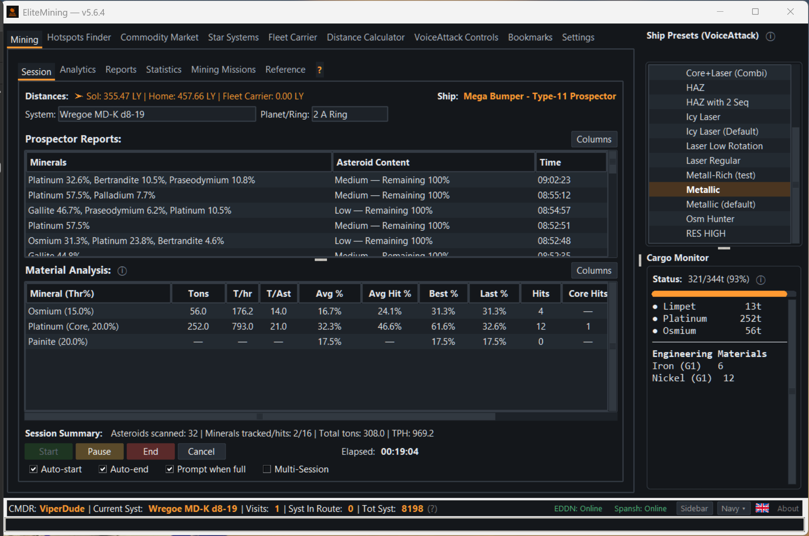 
*Tracks time, prospector reports, minerals, and progress.*

#### Session Options
Tick these under the Start / End buttons:
- **Auto-start** – Starts a session when you fire your first prospector limpet. If a session is paused, firing a prospector resumes it.
- **Auto-end** – Ends and saves the session when you enter supercruise or jump. The refinery and comment questions are skipped, and anything still in your refinery is not counted. Sessions with nothing mined are discarded. Not available with Multi-Session.
- **Prompt when full** – Asks if you want to end the session when your cargo hold has been 100% full and idle for 1 minute. Turn this off if you want Auto-end to run with no pop-ups. Not available with Multi-Session.
- **Multi-Session** – Keeps one session running across several cargo loads (mine, sell, return) and reports them as one. The session only ends when you press End.
- **Auto Switch** – Switches to the Mining Session tab when you fire a prospector and back to Hotspots Finder after the session ends, only after 30 seconds without app activity and while no search or modal dialog is open; skipped switches wait for the next trigger.

For a fully hands-free setup, tick **Auto-start** and **Auto-end** and turn off **Prompt when full**. Sessions then start and save by themselves.

#### Mining Analytics

Open **Mining → Analytics** to compare yields over time and the materials collected. Use the charts to review how your mining performance changes during a session.

View analytics charts

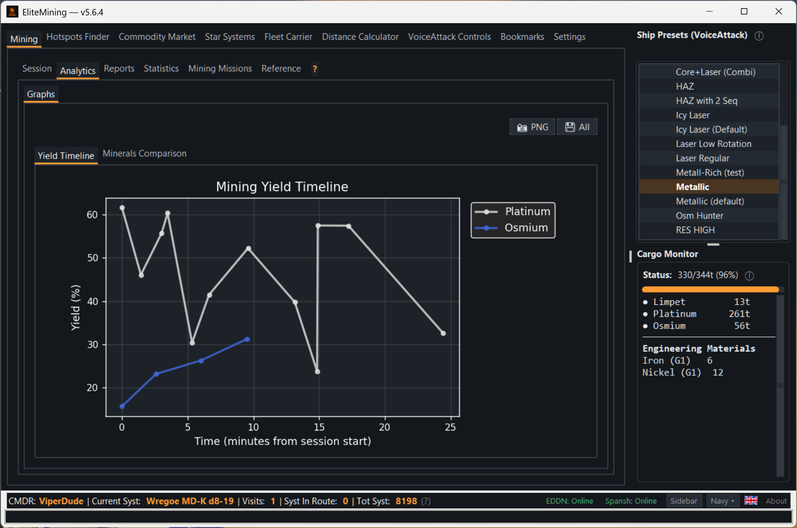 
*Mineral percentages over the session timeline.*

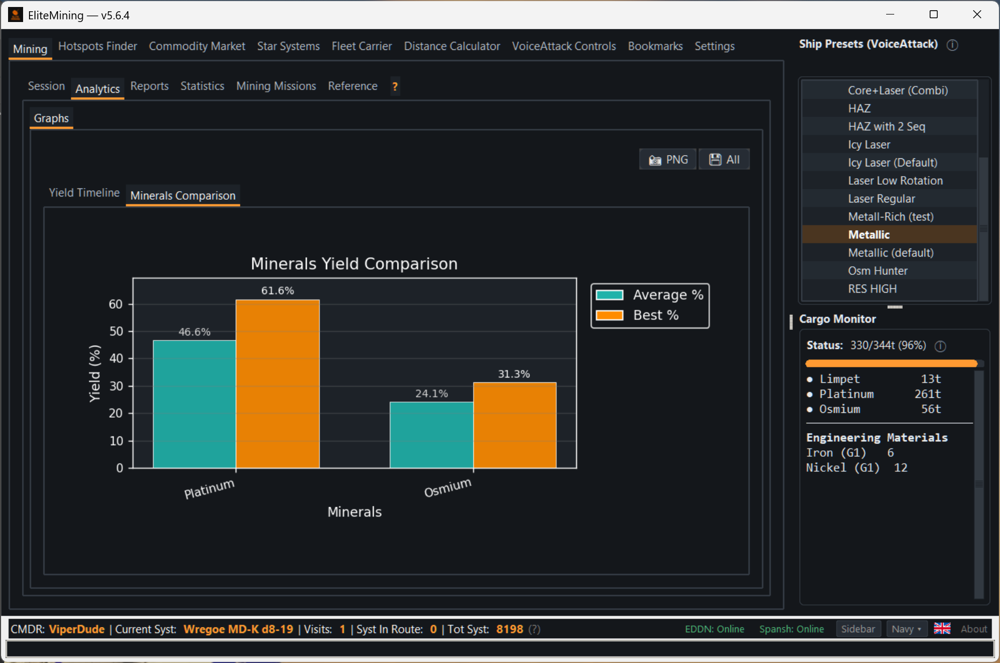 
*Minerals collection comparisons.*

#### Reports

Open **Mining → Reports** to review saved sessions. Right-click a session to generate a detailed report, attach screenshots, or create a mining card.

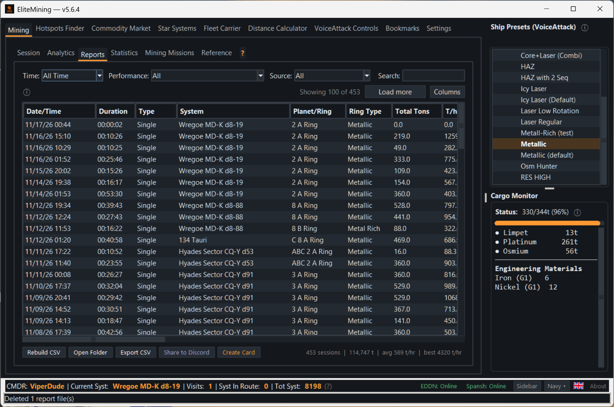 
*Detailed mining statistics and summaries.*  
- **Ring Type** column next to Planet/Ring (blank if the ring isn't in your saved ring data)

#### Detailed HTML Reports  
*HTML reports with charts and statistics.*  

> Report layouts and calculations may change as the detailed report system develops.

Detailed reports include:
- **Dark/Light Theme Toggle** - Switch between themes with one click  
- **Session Comments** - Add notes and observations to your reports  
- **Visual Charts** - Minerals breakdowns and performance graphs  
- **Screenshot Integration** - Attach screenshots to document your sessions  
- **Analytics Tooltips** - Hover explanations for all efficiency metrics
- **Clickable Images** - Charts and screenshots expand to full size
- **Data Preservation** - Reports protected during software updates
- **Export Options** - CSV, HTML, and PDF formats available

**File Locations:**
- Reports saved to: `Reports/Mining Session/`
- Screenshots: `Reports/Mining Session/Detailed Reports/Screenshots/`
- Performance graphs: `Reports/Mining Session/Graphs/`  

Open saved reports from the Reports tab.

#### Discord Integration
*Manually share mining session reports to Discord channels.*  

Set a Discord webhook URL in Settings, then manually share a completed session from Reports. Shared summaries include minerals, yields, mining rate, duration, and your comments.

#### 📊 Mining Cards
Generate shareable PNG cards from your mining sessions.

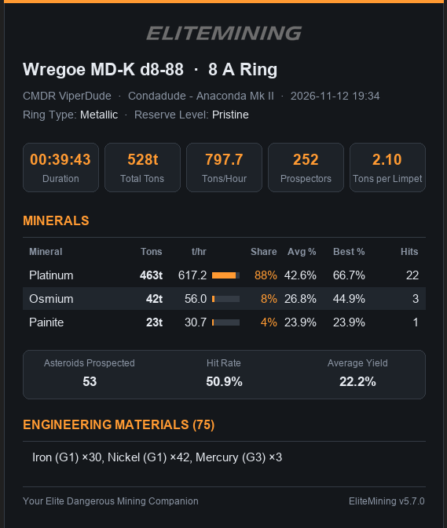 

**Features:**
- Session stats, performance metrics, and commodity breakdown
- Add your CMDR name and optional notes
- Right-click any session in Reports → "Mining Card"

Cards saved to: `app/Reports/Mining Session/Cards/`

📸 View HTML Report Screenshots

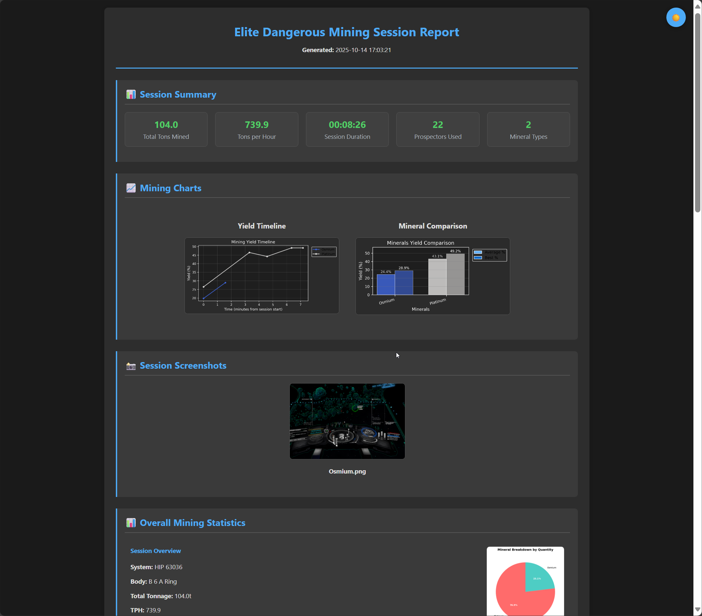 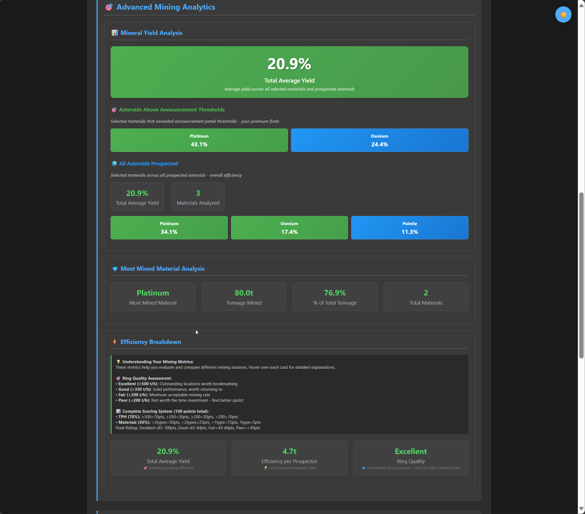 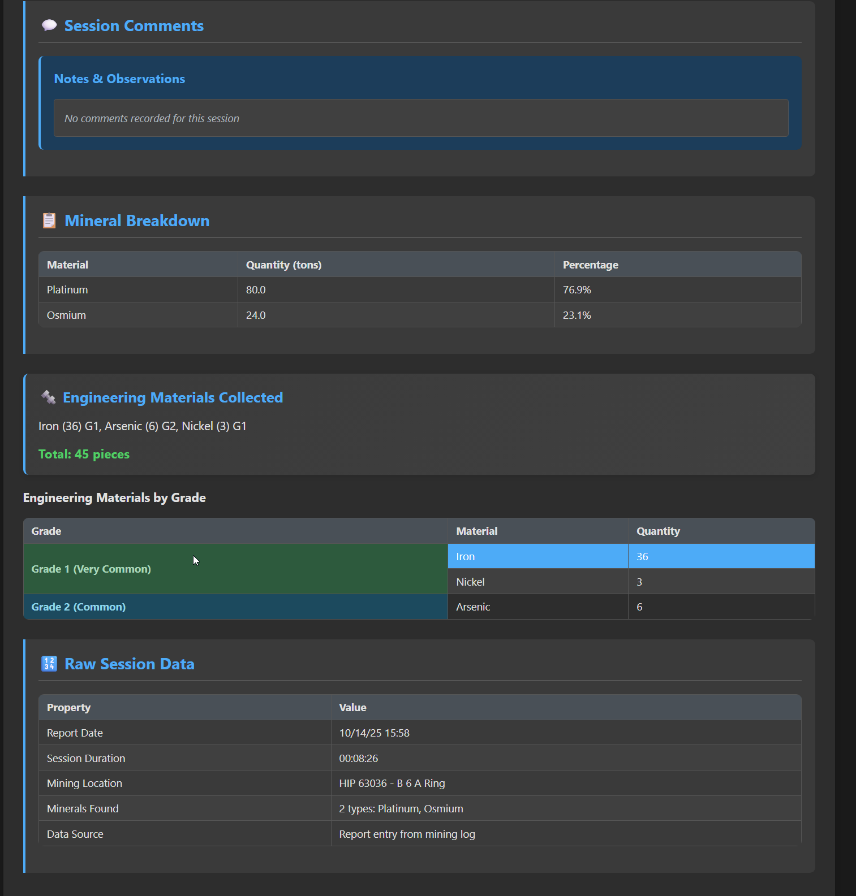

*Click images to view full size*

#### Bookmarks  
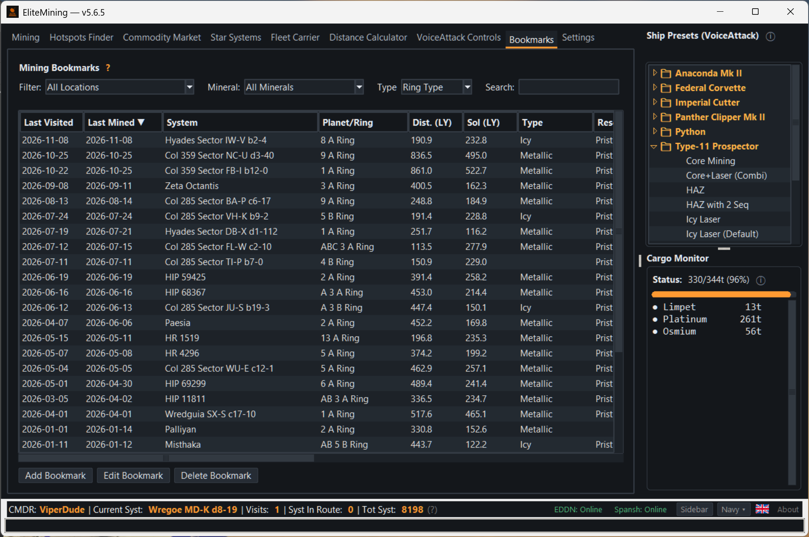 
*Save, search, and manage mining spots.*  
- **Last Visited** column (sortable) with a filter for systems visited in the last 30 days
- **Mineral** dropdown to show only bookmarks containing a chosen mineral
- **Type** dropdown to filter by ring type (Metallic, Icy, Rocky, Metal Rich)
- New columns: distance from current system, distance to Sol, Reserve level and Visits
- **Last Mined** updates automatically from your mining reports
- Bookmarking from a mining report fills in the Ring Type
- **T/hr** shows the session total, or the rate for the chosen Mineral (bookmarks made from a report; older bookmarks keep their old value)
- Hover a note to read the full text

#### Mining Statistics

Open **Mining → Statistics** to review saved mining sessions. Ship, Mineral, and Time filters apply to mining statistics. **Last 20 Visited Systems** and **My Mining Data** work independently of those filters.

- **Overview** — Session totals, averages, and records, plus your latest 10 sessions compared with the previous 10.
- **Top 20 Best Locations** — Locations ranked by their best session T/hr, with average and lowest rates, session counts, and mining time.
- **Last 20 Mining Locations** — Your latest mining locations, newest first. Each system/ring appears once.
- **Last 20 Visited Systems** — Your latest visited systems, with visit dates, distance from your current system, and visit counts.
- **My Mining Data** — Hotspots, rings, mined rings, 2x/3x overlaps, and Low, Normal, High and Haz RES rings for each mineral. **Coverage** shows the percentage of saved rings where you have mined that mineral.
- **Mineral Performance** — Select a mineral to see Avg %, Best %, and Hits from saved reports. These follow your announcement thresholds; T/hr still includes all mined minerals.

The My Mining Data heading shows your commander name when known, and the summary shows saved systems, unique mined locations and your total visited systems. Mined counts use saved mining sessions. The **Total** row sums each column and stays at the bottom when sorting; rings listed under several minerals count in each mineral, and total Coverage uses the summed mined rings divided by summed rings.

Both location tables include **Dist (LY)** from your current system and **LS** from the arrival star. Use **Columns** to reorder or hide columns, and hover over headers for descriptions.

Right-click a location to copy its system, open Inara/EDSM/Spansh, view its report, or search in Hotspots Finder. Double-click a system to open Inara, or another cell to open the report.

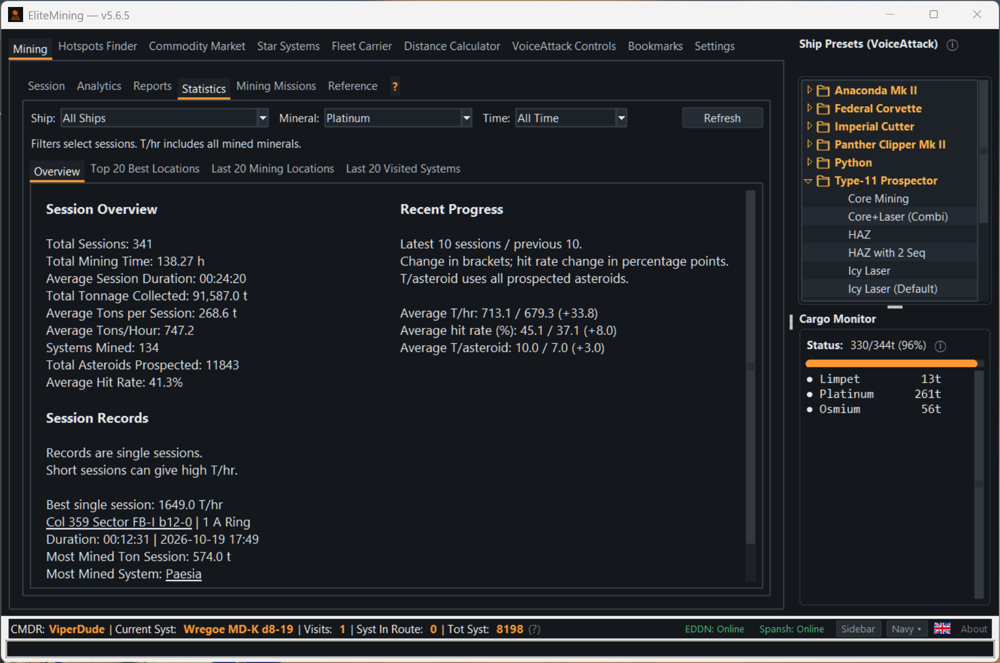 
*Overview: totals, averages, records, and recent progress.*

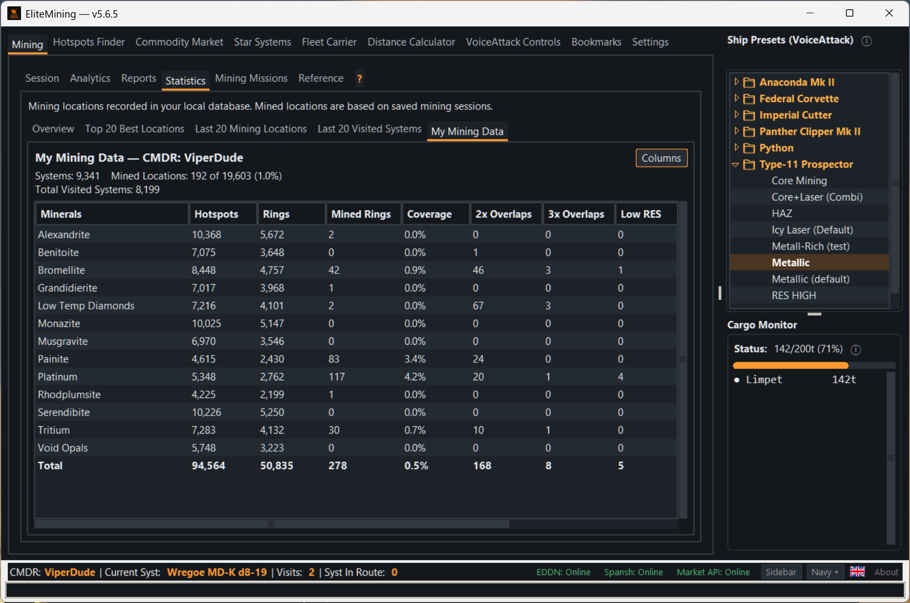 
*My Mining Data: compare saved mining locations and your mined coverage by mineral.*

View location tables and visited systems

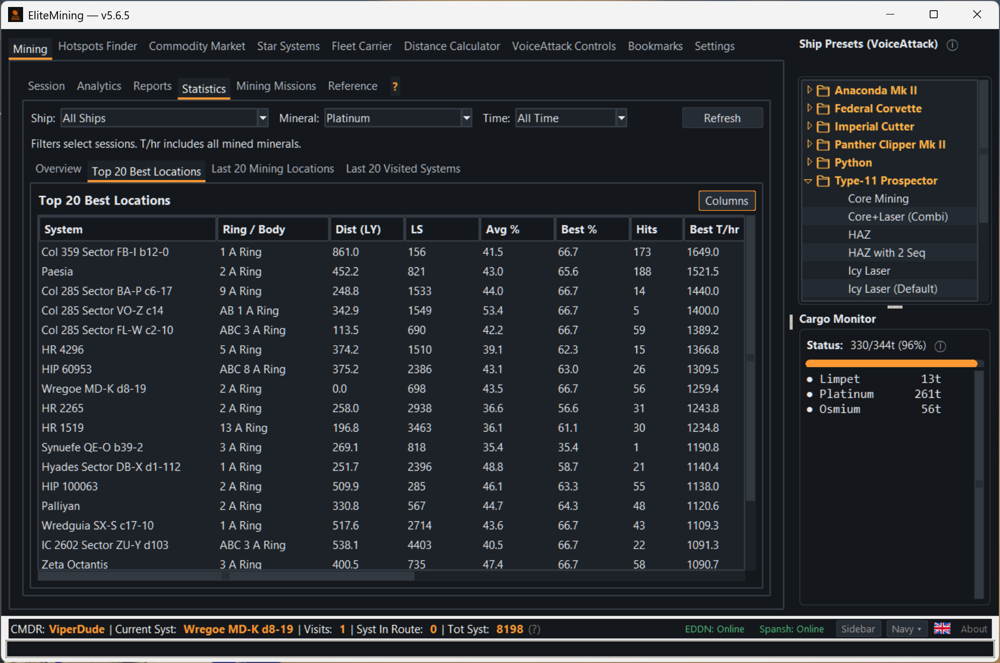 
*Top 20 Best Locations: compare mining rates and mineral performance.*

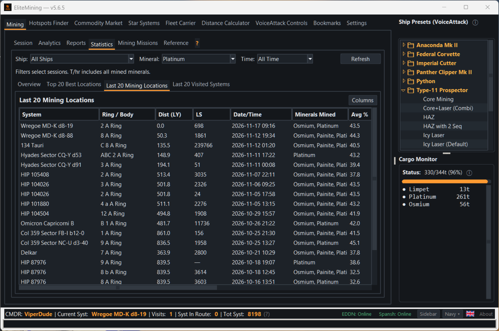 
*Last 20 Mining Locations: recent mining spots and session details.*

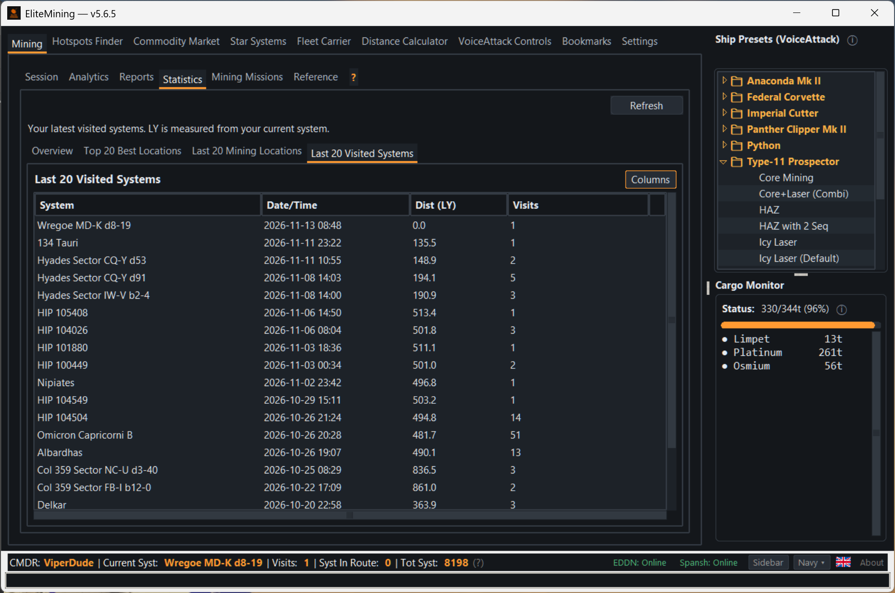 
*Last 20 Visited Systems: recent system visits, distances, and visit counts.*

---

#### Ship Presets & Cargo Monitor Sidebar
*The Ship Presets and Cargo Monitor panels share the sidebar on the right side of the app.*

- **Ship Presets** — double-click a preset to apply it to VoiceAttack; right-click for save, edit, duplicate, rename, export/import, and delete options. Includes the Anaconda Mk II.
- **Auto-load** — right-click a preset under any ship type and enable **Auto-load**. You can set up all ship types without switching ships in-game. Each ship type has one automatic preset; choosing another preset for that type replaces the previous choice. It loads at app startup and when you switch to a ship of that type. Unsaved changes still prompt before switching; uncheck **Auto-load** to remove the assignment.
- **Open Folder** — right-click a preset, ship group, or empty space in the preset list and choose **Open Folder** to open the ship preset folder in Windows Explorer.
- **Preset highlights** — the active preset stays highlighted and bold; a clicked row uses a separate selection color. Single-click selects, double-click loads.
- **Cargo Monitor** — live cargo hold status, updated in real time while mining.
- **Hide/Show Sidebar** — click the **Sidebar** button at the bottom of the app to toggle the sidebar and reclaim screen space.

---

#### Settings Tab

Open **Settings** and choose **Announcements** for mineral alerts and presets, or **General Settings** for themes, UI scale, session automation, overlays, and backup/restore. Hover over controls for individual explanations. See [Themes](#themes), [Session Options](#session-options), and [Text Overlay](#text-overlay) for details.

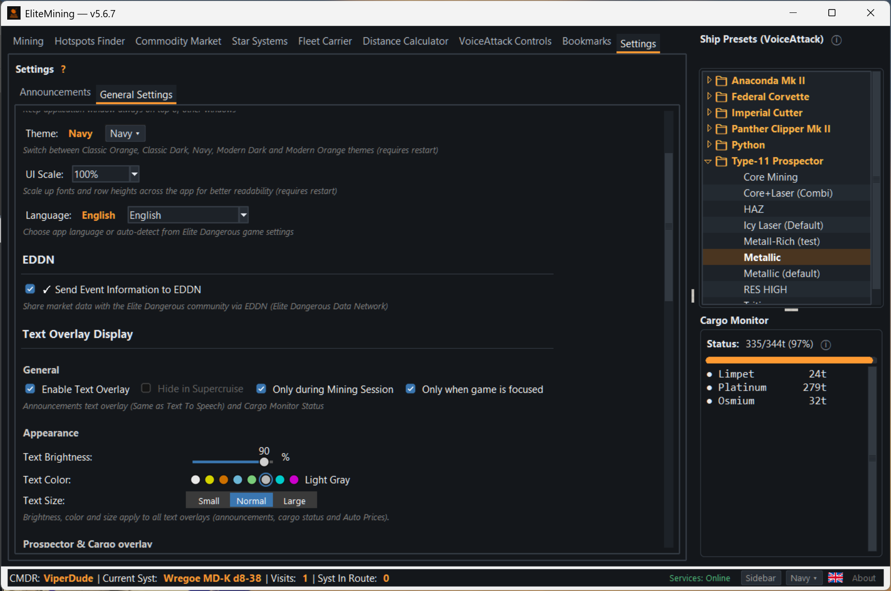 
*UI and announcement preferences.*  

#### Announcement Panel

Open **Settings → Announcements** to choose which minerals trigger alerts and their minimum percentages.

- Enable the announcement types you want, then select minerals and set their thresholds.
- **Set All** applies the shared percentage to all material thresholds. Core-only minerals do not use percentage thresholds.
- Save different choices in announcement presets. Link a preset to a ship preset through the sidebar's right-click menu if you want them to load together.
- Use [Voice Feedback](#voice-feedback) to choose sounds or spoken feedback for mining events.

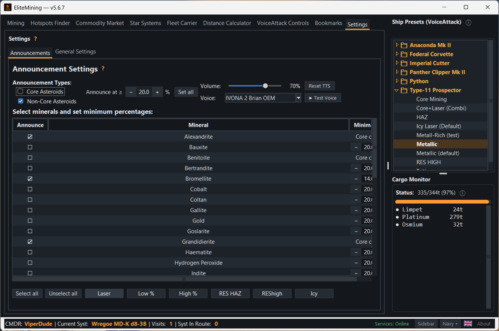 
*Controls announcements, thresholds, and filters.*  

#### Text Overlay  
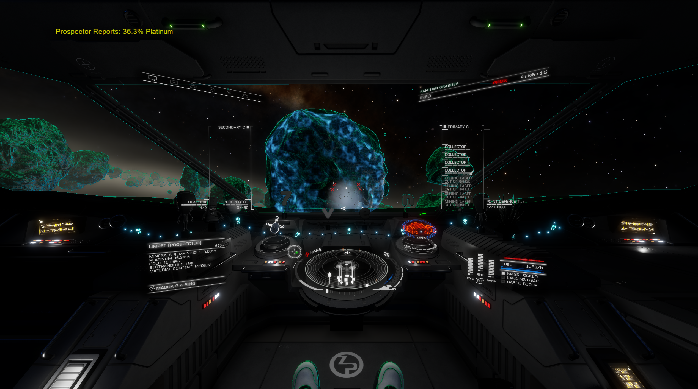 
*Text overlay showing real-time mining announcements in-game.*

View the enhanced text overlay

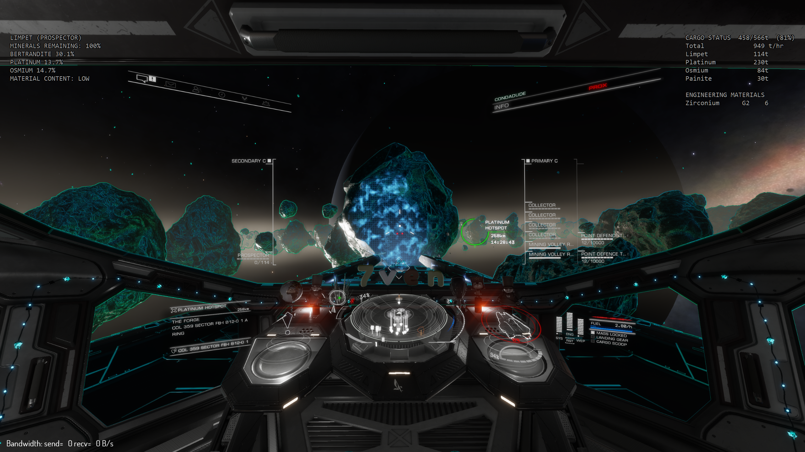 
*Enhanced overlay with improved readability and detailed mining statistics.*

> **Note:** The text overlay automatically follows the game window across monitors. On high DPI scaling settings (above 150%), the overlay position may be slightly offset. For best results, use 100–150% display scaling on the monitor running the game.

> **Hide in Supercruise:** Enable "Hide in Supercruise" in the General Settings tab to automatically hide all text overlays (including cargo status) while in supercruise. Overlays are instantly restored when you drop out of supercruise.

> **Only during Mining Session:** Enable "Only during Mining Session" to show overlays only while a mining session is active. When no session is running, overlays stay hidden to keep your screen clean.

**Auto Prices on the overlay:**

- In Hotspots Finder, open **Auto Options > Auto Prices Options** and tick **Show on overlay**, or enable it in General Settings.
- Requires **Enable Text Overlay**. If that is off, results open in the Best Mineral to Mine window.
- Appears only in supercruise, ignores **Hide in Supercruise**, and uses its own display duration (10–60 seconds).
- Use **+ Also Check** in Best Mineral to Mine to include minerals without hotspots.

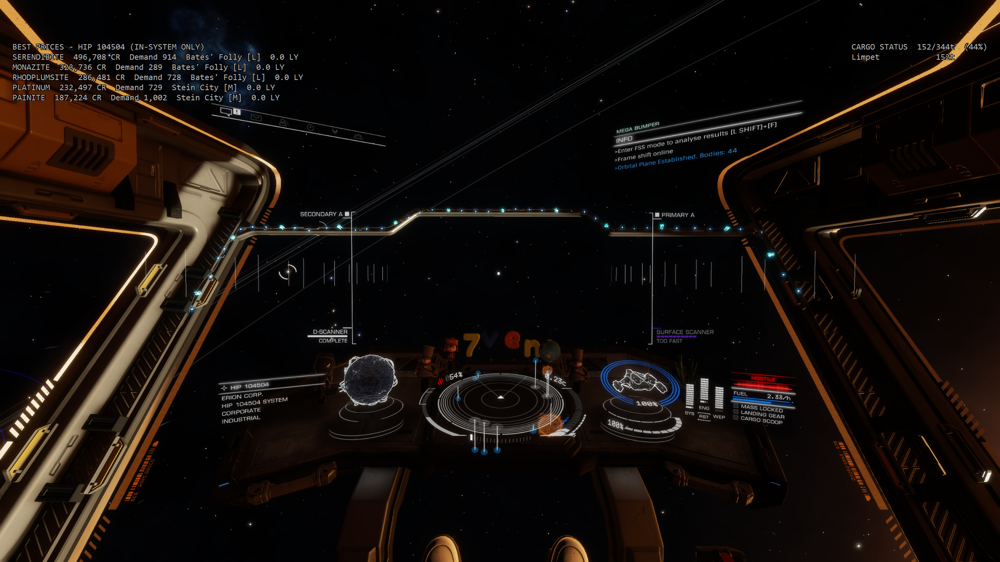 
*Auto Prices on the text overlay: best sell price, demand, station and distance for each mineral.*

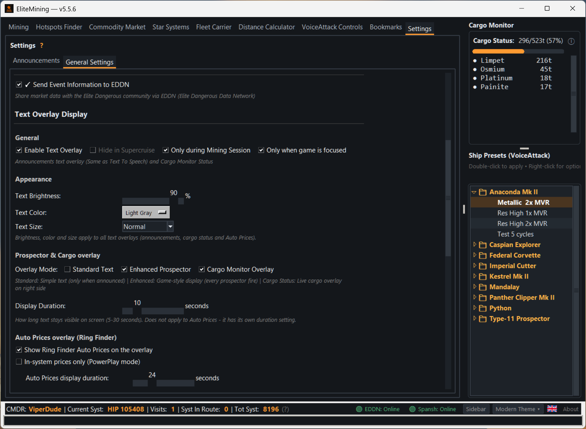 
*Text overlay settings in the General Settings tab.*

[Back to Top](#top)

---

### Backup & Restore 
Open **Settings → General Settings → Backup & Restore**.

- **Backup** — Choose what to include (or select everything), then save the ZIP file.
- **Restore** — Select an EliteMining backup ZIP and choose which available items to restore. Restoring replaces the selected saved data, so create a backup first.

Backups can include settings, ship presets, reports, bookmarks, ring data, journals, and the VoiceAttack profile.

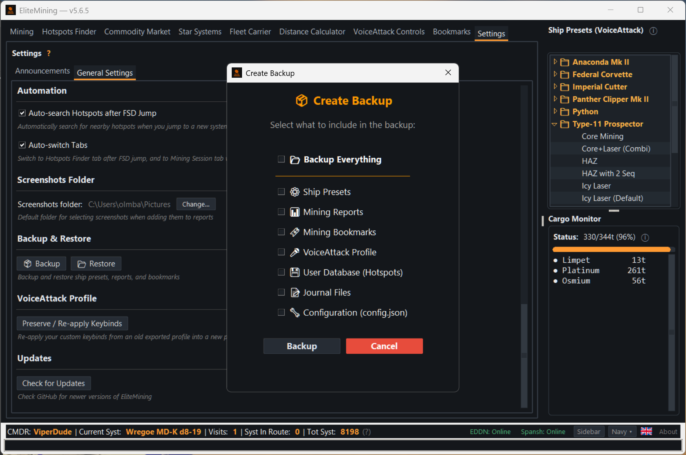 

[Back to Top](#top)

---

## VoiceAttack Commands

Click to expand

Control EliteMining with voice commands. These require VoiceAttack with the EliteMining profile.

### Mining Sequences (Custom Keybinds)
These commands trigger in-game actions. Configure your keybinds in the "Custom Keybinds for Mining Control" category.

#### Repeated Mining Cycles
Configure how many times the laser mining extra sequence runs:
- Adjustable repeat count (1-10 cycles)
- Set in VoiceAttack Controls → Mining Controls tab
- Default: 1 cycle (standard mining)
- Higher values: automated repeated mining without manual restart

| Voice Command | Action |
|---------------|--------|
| Start mining sequence | Begin automated mining |
| Start prospector | Start prospector sequence |
| Deploy Sub-Surface Displacement Missile | Fire SSDM |
| Start Pulse wave scanning | Enable PWA scanner |
| Stop Pulse wave scanning | Disable PWA scanner |
| Deploy seismic charge launcher | Fire seismic charge |
| Clear and jump | Retract hardpoints and jump |
| Deploy weapons | Deploy hardpoints |
| Toggle Listening | Enable/disable voice recognition |
| Stop all | Emergency stop all sequences |
| Reset mining sequence | Reset to default state |

### App Control
| Voice Command | Action |
|---------------|--------|
| Open Elite Mining | Launch the app |
| Close Elite Mining | Close app gracefully |
| Minimize Elite Mining | Minimize to taskbar |
| Restore Elite Mining | Restore from taskbar |
| Hide sidebar | Hide Ship Presets and Cargo Monitor |
| Show sidebar | Show Ship Presets and Cargo Monitor |
| Swap sidebar panels | Swap Ship Presets and Cargo Monitor while the sidebar is visible |
| Find best mining system | Open the best mining system search dialog |
| Bookmark this location | Open the bookmark dialog with the current system and body filled in |

### UI Navigation
| Voice Command | Action |
|---------------|--------|
| Show mining | Switch to Mining Session tab |
| Show mining reports | Switch to the mining Reports sub-tab |
| Show mining statistics | Switch to the mining Statistics sub-tab |
| Show mining missions | Switch to the Mining Missions sub-tab |
| Show hotspots | Switch to Hotspots Finder tab |
| Show market | Switch to Commodity Market tab |
| Show missions | Switch to Mining Missions tab |
| Show ring guide | Switch to Ring Mining Reference tab |
| Show systems | Switch to Star Systems tab |
| Show distance | Switch to Distance Calculator tab |
| Show voice attack | Switch to VoiceAttack tab |
| Show bookmarks | Switch to Bookmarks tab |
| Show settings | Switch to Settings tab |

### Mining Session Control
| Voice Command | Action |
|---------------|--------|
| Start mining | Start mining session |
| Pause mining | Pause/Resume session |
| Stop mining | Stop and save session |
| Cancel mining | Cancel without saving |

### Announcement Presets
| Voice Command | Action |
|---------------|--------|
| Load announcement 1-6 | Load announcement preset |

### Overlay Control
| Voice Command | Action |
|---------------|--------|
| Enable text overlay | Turn on the text overlay |
| Disable text overlay | Turn off the text overlay |
| Enable standard text overlay | Switch to standard text overlay mode |
| Disable standard text overlay | Switch off standard text overlay mode |
| Enable enhanced text overlay | Switch to enhanced prospector overlay mode |
| Disable enhanced text overlay | Switch off enhanced prospector overlay mode |
| Enable cargo text overlay | Turn on the cargo status overlay |
| Disable cargo text overlay | Turn off the cargo status overlay |

### Settings Control
Enable, disable, or check the status of 15 EliteMining settings by voice. Spoken feedback and VoiceAttack log messages use the same "enabled" / "disabled" wording.
| Voice Command | Action |
|---------------|--------|
| Enable cargo scoop | Turn the setting on |
| Toggle off cargo scoop retraction during a reset mining sequence | Turn the setting off |
| What is the cargo scoop status? | Hear whether the setting is on or off |

> 💡 **Tip:** The VoiceAttack profile contains many more commands including firegroup assignments, status checks, and custom sequences. To see all available commands:
> 1. Open VoiceAttack and export EliteMining profile
> 2. Select export → Save Profile to HTML (Quick Reference)

> This generates a complete reference document of all voice commands.

[Back to Top](#top)

---

## Mining Presets

Click to expand

### Customization  
- Create and manage ship presets via the **EliteMining App UI**
- Adjust firegroups/timers on-the-fly  
- Modify via built-in commands  
- Link a ship preset to an Announcement Preset (right-click a ship preset → Announcement Preset) so the right mineral announcements load automatically when you switch ships.

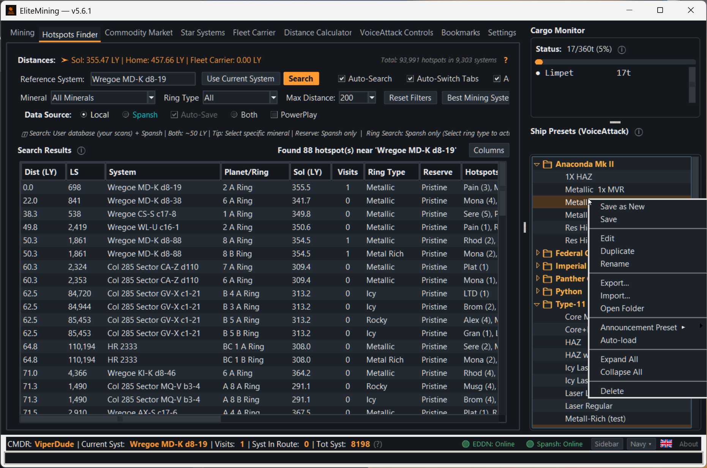 
*Link an Announcement Preset to a Ship Preset via the right-click menu.*

[Back to Top](#top)

---

## Usage Tips
- **Short press** → Starts command  
- **Long press** → Stops/resets command  
- Enable **"Shortcut is invoked when long-pressed"** in VoiceAttack  

[Back to Top](#top)

---

## Compatibility

- Works alongside EDCopilot.

## Known Limitations
- **Only works with in-game keybinds (HOTAS setup manual)**
- **DPI / Resolution changes require restart** — If you change your display DPI scaling or screen resolution, restart EliteMining for the text overlays to render correctly.

> **Note:** VoiceAttack startup warnings about EliteVA plugin bindings are normal due to recent Elite Dangerous changes and can be safely ignored – they don't impact EliteMining voice commands.

[Back to Top](#top)

---

## Training Speech Recognition

Click to expand

1. Open VoiceAttack  
2. Go to **Help → Utilities → Recognition Training**  
3. Train in a quiet environment  
4. Backup your speech profile: [SpProfileMgr.zip](https://voiceattack.com/filesend.aspx?id=SpProfileMgr.zip)  

[Back to Top](#top)

---

## Community & Resources

### Discord
Join our Discord server for real-time help, mining tips, and community discussions:  

**Your feedback is always appreciated!**

[Back to Top](#top)

---

## License & Third-Party Notices  

**EliteMining** © 2024-2026 CMDR ViperDude (Viper-Dude).  
Licensed under the [GNU General Public License v3.0](LICENSE).  

This program is free software: you can redistribute it and/or modify it under the terms of the GNU General Public License as published by the Free Software Foundation, either version 3 of the License, or (at your option) any later version.

This program is distributed in the hope that it will be useful, but WITHOUT ANY WARRANTY; without even the implied warranty of MERCHANTABILITY or FITNESS FOR A PARTICULAR PURPOSE. See the GNU General Public License for more details.

**Third-Party Components:**  
- **ELITEVA** © 2023 Somfic – MIT License  

For complete license terms, see the [LICENSE](LICENSE) file in the repository.  

[Back to Top](#top)

---

## Credits  
- [Somfic](https://docs.somfic.dev/projects/eliteva) – Creator of EliteVA  
- [Iain Collins](https://github.com/iaincollins/ardent-api) – Developer of Ardent API for Elite Dangerous market data  
- [EDCD/EDDN](https://github.com/EDCD/EDDN) – Elite Dangerous Data Network for real-time game data  
- **gOOvER | CMDR Shyvin** – For continued support and contributions to this project

[Back to Top](#top)

---

## FAQ

For detailed answers to common questions, see our [FAQ page](FAQ.md).

[Back to Top](#top)

---

**Disclaimer:** This project is not affiliated with, endorsed by, or associated with Frontier Developments plc. All trademarks and copyrights are the property of their respective owners.
